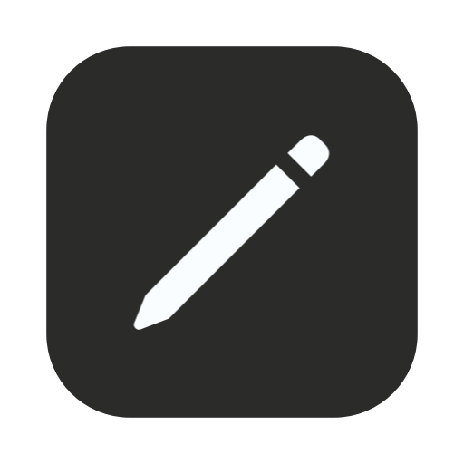
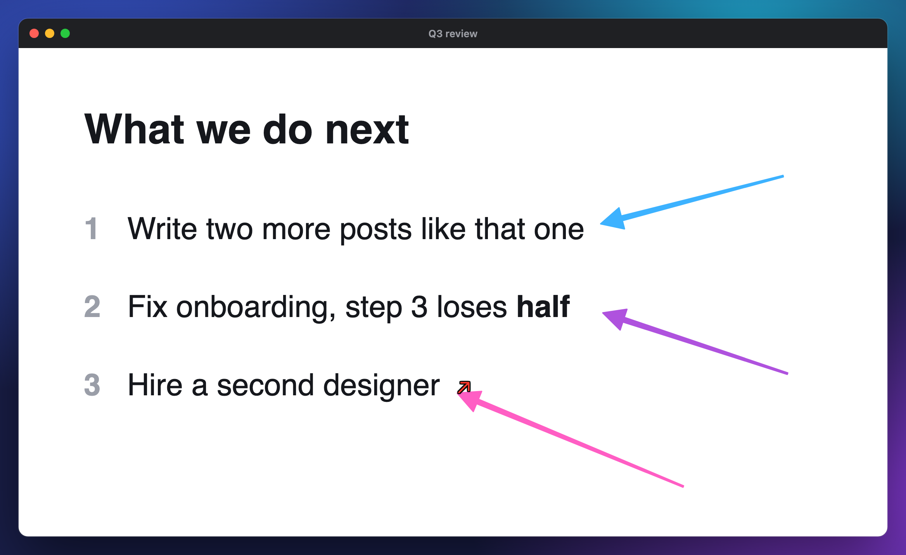
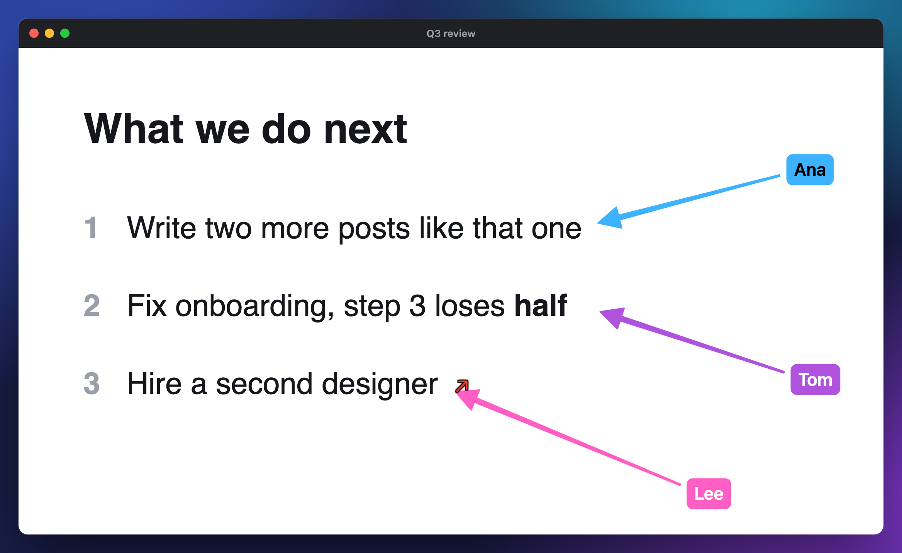
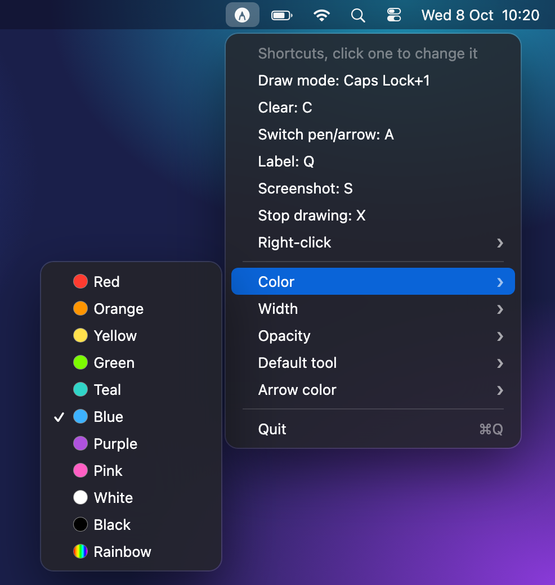

<p align="center">
  
</p>

<h1 align="center">Highlighter</h1>

<p align="center">
  Draw on your screen while you present.<br>
  A tiny Mac menu bar app, free and open source.
</p>

<p align="center">
  
  <a href="LICENSE"></a>
</p>

<p align="center">
  
</p>

Press a shortcut and your cursor turns into a pen. Circle a number, underline a line, point at things with arrows and label them. Go to the next slide and the drawings are gone, the pen stays on.

I built it because I wanted Canva-style highlighting in Google Slides, and Slides only gives you a laser pointer. It does one thing and I'd like to keep it that way. It's omakase style, so if you'd like something changed, fork it or open an issue.

## How to use it

| Key | What it does |
| --- | --- |
| ⌘⌃⌥⇧1 | Draw mode on. Press it again to stop |
| Drag | Draw, on any screen |
| ← → ↑ ↓, Space, Page Up, Page Down | Your slide changes and the drawings clear, draw mode stays on |
| C | Clear, the slide stays |
| A | Switch between the pen and the arrow |
| Q | Label your drawings, Return goes to the next one |
| S or right-click | Screenshot to the clipboard, then draw mode off |
| X or Esc | Draw mode off, drawings gone |

Your slides keep focus the whole time, so the clicker and arrow keys still work. While draw mode is on the app swallows C, X, S, A and Q, so they won't type into whatever has focus.

⌘⌃⌥⇧ is the "Hyper" key. I map Caps Lock to it with [Karabiner-Elements](https://karabiner-elements.pqrs.org), so for me it's just Caps Lock+1, and the menu says that. Without Karabiner you press all four modifiers plus 1, or pick another shortcut in the menu. It needs a modifier, since it works everywhere.

## Arrows

<p align="center">
  
</p>

Press A and the cursor turns into an arrow. Drag from the tail to the tip. Press A again to get the pen back, the arrows you drew stay.

Set "Arrow color" to "New color each arrow" and every arrow gets its own color: the first one takes your color, the next ones walk through the other seven (White, Black and Rainbow are skipped). That way you can say "the blue arrow is this, the pink one is that". Clearing starts the colors over. "Default tool" picks whether draw mode starts with the pen or the arrow.

## Labels

<p align="center">
  
</p>

Press Q to label your drawings. A caret shows up on the first drawing without a label. Type the label and press Return to go to the next drawing. After the last one you're back to drawing. Esc or a click stops earlier.

Each label is a pill in its drawing's color. It sits behind an arrow's tail, or next to where a pen stroke starts, on the outside of a circle. Labels clear with the drawings. While you type, your keys don't reach the slides.

## Screenshots

Press S to copy a screenshot of the screen your cursor is on, drawings included, to the clipboard. Draw mode turns off right after. Right-click does the same by default, the Right-click menu can switch it to another action.

You can also use your own screenshot app. Its area selection (CleanShot's, for example) sits above the drawings, so they end up in the shot. Once you let go of the selection and the app has copied the shot (half a second at most), draw mode turns off and the drawings clear, like with S.

## Settings

<p align="center">
  
</p>

The pencil in the menu bar has the settings: color (ten colors plus rainbow), width (3, 6, 12 or 26 px), opacity (50, 85 or 100%), the default tool and the arrow color. The app remembers them. Default is blue, 6 px, 100%.

To change a shortcut, click it in the menu and press the new one (Esc cancels). Esc and the slide keys are fixed, at the top of `main.swift`.

## Install

You need macOS 13 or newer and the Xcode Command Line Tools (`xcode-select --install`). No Xcode project, the whole app is one Swift file.

```sh
git clone https://github.com/Pawel-Kica/highlighter.git
cd highlighter
./build.sh
open /Applications/Highlighter.app
```

`build.sh` compiles `main.swift` and puts the app in `/Applications`. To build it somewhere else, run `APP=~/Desktop/Highlighter.app ./build.sh`.

On first launch it asks for Accessibility. Allow it in System Settings > Privacy & Security > Accessibility. It only needs that to see the slide keys and Esc, and to take your typing for labels. Drawing and the hotkey work without it.

The first time you press S, macOS asks for Screen Recording. Allow it and open the app again.

It also adds itself as a login item, so it starts with your Mac. You can turn that off in System Settings > General > Login Items.

The app is signed ad hoc, not notarized. If macOS blocks it the first time, go to System Settings > Privacy & Security and click Open Anyway.

Ad hoc signatures change on every build, so after a rebuild macOS will ask for Accessibility again. If you have a signing certificate, pass it in and the permission sticks:

```sh
SIGN_IDENTITY="Apple Development: you@example.com (XXXXXXXXXX)" ./build.sh
```

`security find-identity -v -p codesigning` lists the ones you have.

After a rebuild, restart the running copy with `pkill -x Highlighter; open /Applications/Highlighter.app`.

The icon comes from `make-icon.swift`. Run `swift make-icon.swift` to regenerate `AppIcon.icns`.

## License

MIT
